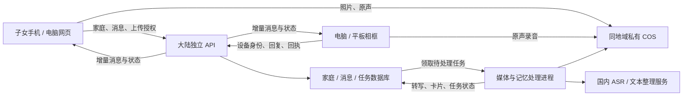

# AI 记忆相框：独立项目与国内公测计划

2026-09-23 · 早期调研留档，以下方案已被当天 Demo 的执行路线更新。

**最新状态：已使用19.90元/月的上海 CloudBase 个人版上线双端 Demo，通过平台 HTTPS 测试域名访问，不等待自有域名备案。真实照片/原声跨端传输、腾讯ASR和混元hy3均已联通。** 当前执行结果、入口与限制以 [Demo上线记录](../memory-frame-demo/DEPLOYMENT.md) 为准。下文“尚未实施”“未购买”等描述保留调研当时的状态，不代表最新进展；195元轻量服务器候选未购买。

## 1. 结论与范围

将用户提供的《AI记忆相框_v4_手帐粉蓝_锁档.html》做成独立产品。保留粉蓝手帐界面和“子女发照片—长辈讲故事”的交互；选择性复用 Unseen 的上传、媒体校验、语音适配及运维经验，建立独立服务、账号和数据。原 Unseen 暂时保留，本轮不迁移、不改造其线上环境。

按用户已确认的手机端 + 网页/电脑端：子女使用手机网页，电脑/平板浏览器承载相框端；家庭管理页面也适配电脑。以后专用相框硬件可以接入同一套接口。

首个目标：**手机发一张真实照片到另一网络上的电脑相框；相框录下一段真实声音传回手机；两端刷新后照片和原声仍在。** AI 转写和卡片整理随后接入，失败不阻塞原声收发。

用户补充确认：**旧域名尚未备案，主要顾虑是等待时间。** 因此把“开发是否等待备案”和“何时开放公网访问”分开安排：正式大陆部署仍是目标；备案与本地/受限环境开发并行，或先香港试点再安排备案迁移。两条路线的取舍见第 3 节，不把香港过渡默认当成已获部署授权。

## 2. 原型现状

原文件未改动。已保存字节一致的[参考副本](../reference/memory-frame-v4.html)和[来源清单](../reference/source-manifest.json)。SHA-256：`5848c5495e8feeecd884420198fc42d1be21725d1cbe220026d69a3c6ea664c5`。本次已阅读脚本并在浏览器查看界面。

| 功能 | 源码实际行为 | 产品化工作 |
| --- | --- | --- |
| 双端同步 | 609、846 行：同一个页面共享内存变量 S | 两个独立入口、持久数据库、跨网络消息 |
| 上传照片 | 808 行：创建本机 Object URL | 云端上传、校验、预览和授权读取 |
| 子女/相框录音 | 835–839、888–904 行：计时和动画 | 真麦克风采集、音频持久化、上传与重试 |
| 原声播放 | 729–734 行：浏览器 TTS 朗读文字 | 原始音频播放器；机器朗读另行标识 |
| AI 识别与卡片 | 820、909–926 行：延时填入预设标签/故事 | ASR、结构化提取、异步任务、人工修订 |
| 家庭邀请 | 775–786 行：固定邀请码、模拟二维码 | 限时邀请、真实二维码、接受与撤销 |
| 相框在线 | 静态在线文案 | 配对、设备身份、心跳、离线待投递 |
| 3D 链接 | 826 行只检查 URL；743 行平移单张图片 | 单独验证格式、供应商接口和真实查看器 |
| 推送 | 当前页面内 banner | 先做站内提醒与补拉，后台系统推送另排期 |

当前没有真实服务端调用或照片/录音持久化。“发送成功”“已录好”“五秒内出文字”属于演示状态。

## 3. 部署、域名与备案：现在怎么买

### 推荐组合

**腾讯云中国大陆轻量应用服务器 + 同地域私有 COS + 旧域名的新子域名 + 独立 Node API。**

| 资源 | 建议 | 原因/边界 |
| --- | --- | --- |
| 地域 | 上海作为候选；若首批家庭集中华南，优先测广州 | 不存在未测就能保证“全国最快”的地域；以目标家庭三网测试决定 |
| 服务器 | 首轮 3–5 家庭优先 2 核 4 GB，媒体任务限并发；需要更多处理并发时再升 4 核 8 GB | 使用外部 ASR/文本模型；规格不是并发保证 |
| 计费 | 大陆包年包月，至少累计购买 3 个月；备案期间剩余至少 1 个月 | 选择满足备案条件的正式实例，不仅看“测试机”标签 |
| 网络 | 有大陆公网 IP、非零带宽；购买页确认备案资格 | 试用、按量或竞价资源不能当成已经具备备案资格 |
| 系统 | 受支持的 Linux LTS，按运行依赖锁定版本 | 第一版不需要 Windows 或 GPU |
| 图片/录音 | 同地域私有 COS，临时授权上传/下载 | 应用机只处理业务、权限和有限媒体任务 |
| 数据库 | 独立 SQLite/WAL + 持久任务表，小规模单实例起步 | 多实例写入或高可用需求出现后再评估 PostgreSQL |
| 模型 | 已验证可从大陆调用的 ASR/文本整理接口 | 首轮不购买 GPU 自跑大模型 |

腾讯云 2026-09-21 更新的规则明确：CVM/轻量用于备案需中国大陆资源、包年包月购买至少三个月、备案期间剩余至少一个月，并满足公网 IP/带宽要求。购买页的具体实例资格仍需复核。[备案云资源要求](https://cloud.tencent.com/document/product/243/18908)

服务器可以买来用于开发并在后续承载小规模公测，不需要因为“从测试变公测”必然再买一台。测试/公测的数据和配置需分开；正式扩大规模后再看隔离与容量需求。

### 旧域名可以优先沿用

2026-09-23 查询公开 RDAP，`maxxam.xyz` 的注册商为 **Alibaba Cloud Computing Ltd. d/b/a HiChina（阿里云/万网）**，域名到期日为 2027-07-27。用户已明确确认尚未备案；域名实名认证尚需核对。[域名注册信息](https://rdap.centralnic.com/xyz/domain/maxxam.xyz)

建议使用尚未创建的 `frame.maxxam.xyz`，下面分 `/family` 和 `/frame`；只增独立解析记录，不改旧 Unseen 子域名及现有 DNS 服务商。子域名无需另行购买一个域名。服务器在腾讯云、域名在阿里云可以配合使用；按腾讯云规则，域名只需由合规境内注册商管理且实名/备案主体等条件满足，不要求一定转入腾讯云。[域名备案条件](https://cloud.tencent.com/document/product/243/19627)

按用户确认的未备案状态，后续需办首次备案或按主体已有记录新增服务。子域名也不会绕过主域名的备案要求。项目改由不同主体运营、旧域名归属不匹配，或需要独立品牌时，再考虑新域名；买新域名本身不能免去备案。[腾讯云“是否需要备案”](https://cloud.tencent.com/document/faq/243/19630)

### 备案与开发同时推进

大陆公开提供网页服务按备案流程准备。官方写明腾讯云初审通常 1–2 个工作日，管局审核不超过 20 个工作日；材料补正等会影响实际日期，不承诺几天一定完成。[备案流程](https://cloud.tencent.com/document/product/243/18909)

顺序：核对域名实名/备案主体 → 核对或购买合格实例 → 提交相应备案 → 同期本地及受限开发环境联调 → 备案与 HTTPS 就绪 → 国内真机验证 → 小批公测。不能把裸 IP/换端口当成正式公测免备案方案；手机麦克风正式访问也需要 HTTPS 安全上下文。

用户已完成腾讯云登录。本次轻量服务器列表显示一台中国香港实例 `Ubuntu-qbqy`，运行中，2 核 / 2 GB / 50 GB 系统盘，到期时间 2026-10-14 22:16:35。它与旧服务文档记载的服务器对应；该地域不能作为本次大陆备案资源。当前轻量列表未显示大陆实例，其他产品资源未做全账号穷举。

腾讯云“我的备案”当前显示新人指引，未展示成功备案；“备案查询”明确提示系统维护建设中，需转工信部官网查询。未备案状态依据用户后续明确确认，而非从维护页面推断。域名实名认证仍需在注册商核查。本次未购买资源、修改 DNS 或提交备案。

已在登录态购买页配置一份候选：上海 / Ubuntu 24.04 LTS / 锐驰型 2 核 4 GB / 50 GB SSD / 标称 200 Mbps 峰值带宽 / 1 台 / 3 个月，2026-09-23 页面总价 **195 元**。额外存储包、主机安全付费项、自动续费和服务协议均未勾选，未点击购买或提交订单。200 Mbps 是共享资源调度的峰值，不是保证持续带宽；该价格也不是全项目费用。优惠活动仍需按当前账号资格比较，不套用广告中的新客价。

### 备案等待怎么处理

| 路线 | 开发与开放访问 | 适合的优先级 |
| --- | --- | --- |
| 大陆部署，备案与开发并行 | 买合格大陆实例并准备备案；本地/受限环境先实现双端，备案完成后开放公网测试 | 正式服务确定在大陆，希望少迁一次；建议作为主计划 |
| 香港先试点，后续再迁大陆 | 独立香港应用先做 3–5 家庭试点；模型、存储和录音网络路径一并实测；稍后安排备案及迁移窗口 | 先验证家庭愿不愿意用，暂不想启动备案流程 |

腾讯云官方明确，托管于香港的网页无需大陆 ICP 备案；大陆网页需要先完成备案。这里讨论浏览器网页，不据此推导原生 App/小程序的上架、备案要求。[地域与备案](https://cloud.tencent.com/document/faq/243/19630)

**首次备案审核期间，备案网站需要关闭访问。** 因此不能承诺 `frame.maxxam.xyz` 在香港持续公开可用的同时，首次备案全程不受影响。开发、测试样本准备与备案资料准备可以并行；正式提交时须核对管局/接入商要求与关闭范围。旧域名还承载 Unseen，未核清关闭范围前不提交影响旧站的变更。若未来必须保证旧站长期独立运行，可另选新项目专用域名，但这不是现在打通双端的必要开销。[备案审核期间访问要求](https://cloud.tencent.com/document/faq/243/19650)

现有香港机器仅 2 GB 内存，尚未读取运行负载、磁盘余量及部署权限。不能因“已经有服务器”就认定还能稳定承载新产品。默认旧 Unseen 保持原状；若以后决定共用硬件，需先做容量核查，以独立进程/容器、数据库、目录与端口部署。否则用短期独立香港实例，价格需另报价；195 元仅是上面的上海方案。

香港阶段先用香港同地域存储避免业务跨区来回传文件；客户端仍可能受跨境网络影响，不能保证与大陆同速。迁大陆并非直接修改实例地域：需要新目标实例、数据库与对象迁移、校验、短暂冻结写入和 DNS 切换；消息中保存对象 ID 而非写死地域 URL，设备地址统一经域名发现，降低迁移改动。[实例地域不能直接变更](https://cloud.tencent.com/document/faq/213/17276)

当前原型还没有真实后端。开发初估本身约 3–4 周，备案与开发同时推进有机会减少额外等待，但不保证两者同日完成。只买服务器无法把演示文件立刻变成可公测产品。

## 4. 怎样让操作体验快

国内部署主要改善国内家庭到业务服务/存储的网络路径；它不会自动缩短 AI 推理时间。分别优化三个阶段：

1. **点一下就有反馈：**本地立即预览照片、显示真实录音状态；操作反馈与“已上传/已送达”状态区分。
2. **文件尽快到另一端：**照片和录音直传对象存储，展示优先下载缩略图/预览；消息只传 ID、状态和短文本。相框预取当前/下一条内容，并持有可补拉的收件箱。
3. **AI 后台完成：**原声确认保存后，子女先能听；ASR/整理异步生成卡片，显示处理进度。减少重复识别，限制并发并保证队列可恢复。

COS 官方支持服务端发放指定对象的临时签名后由网页直传。服务端内容校验、音频转换仍需读取对象；同地域访问、CPU 并发和临时磁盘要实测。[COS Web 直传](https://intl.cloud.tencent.com/zh/document/product/436/9067?lang=zh)

## 5. Unseen 的复用决定

| 方案 | 评价 |
| --- | --- |
| 新 UI 直接挂旧线上服务 | 会耦合旧账号、权限、发布和运行环境，家庭/设备仍需新增；不推荐为默认路线 |
| 独立服务，提取可复用组件 | **推荐**；复用媒体校验、幂等/版本处理、ASR 适配和运维经验，独立管理新业务 |
| 所有能力从零重写 | 增加重复工作，仅在旧组件耦合过深时按模块选用 |

重点参考旧 `services/api/src/ports/media`、`upload-service.mjs`，回见 `lib/moment-local-whisper.mjs`、`moment-provider.mjs` 及相关测试。先用 1–2 天判断能否隔离复用，不为了复用带入整个婚礼空间/历史合同系统。

不能直接假定旧云存储已可用：所查旧 `cloudbase` 目录是未接入的 OSS 原型，本地直传仍落服务器文件；旧授权校验还有特定请求头和 URL 约束。所查旧本地 Whisper 有时长/并发限制，也不能作为“五秒转写”保证。旧 README 记载服务器在香港，本次大陆部署需要独立目标环境。[旧架构](https://github.com/maxi-max-dev/unseen/blob/8d366ec22d82f49ea4da36b84a77c6bf15aa77a7/README.md)

新项目单独实现：家庭与成员、设备配对、消息收件箱、送达/播放回执、录音关联、人物关系、记忆处理任务。人物档案和登录账号分开：记忆里的家人不必都注册账号。

## 6. 双向数据路径

子女发照片/文字/录音：登录家庭 → 申请上传项 → 直传 COS → commit 服务端校验并固定最终对象 → 创建消息与事件 → 相框下载、缓存、确认收到 → 用户播放后记录播放状态。界面区分“云端已保存”“相框已收到”“已听”。

相框回复：点击红色按钮开始真实录音，并在开始时固定 photoId/messageId → 停止后保存本机待发任务 → 直传、校验、收到服务端确认 → 子女可听原声 → ASR 与信息提取任务生成记忆卡片。新照片到达不能把正在录制的故事关联到另一张照片。

网络失败时沿用同一业务 ID 重试；上传成功但 commit 失败时先查询状态。文件待校验与可见文件分开；不能仅凭客户端成功或对象 ETag 判断内容可靠。短时签名不天然等于一次性凭证，已提交对象需要不可覆盖或固定最终版本的机制。

相框用短时一次性配对码绑定，设备权限可撤销且仅限其家庭收件箱/回复；不能拿家庭管理员完整会话长期运行。心跳决定“在线/离线”，断线用游标补拉；事件与业务变更一致持久化。

## 7. 录音、AI 与产品边界

录音使用 HTTPS 下的 getUserMedia/MediaRecorder，运行时检测格式，服务端转码为两端可播版本。分片保留 MIME 和顺序，不假定每片都能独立播放。先建议每条 3 分钟上限，明确提示继续下一段；断网暂存需检查容量，不能承诺网页被系统清理后录音永不丢失。[麦克风要求](https://developer.mozilla.org/en-US/docs/Web/API/MediaDevices/getUserMedia)、[格式检测](https://developer.mozilla.org/en-US/docs/Web/API/MediaRecorder/isTypeSupported_static)

原声、机器转写、人工修订和 AI 摘要分别保存。人物/年份/地点不确定时保留未知，由家庭成员确认；“你爸/姑姑”按说话人关系解析，不能固定套用子女视角。不将合成音频标为奶奶原声，不把 AI 推断写成老人亲口说过的话。

ASR 优先评估腾讯云国内接口，使用真实目标口音小样测质量与延迟，保留可换供应商的接口。结果通过回调/轮询取得，系统使用自己的业务任务 ID；原型“五秒出文字”先撤掉固定承诺。[ASR 任务查询](https://cloud.tencent.com/document/api/1093/37822)

原型中“不用于训练”“加密存储”“随时删除”的文案要对应实际模型服务条款/配置、存储设置与删除/备份期限。家庭默认私有，跨家庭读文件、发消息、读事件都做服务端权限检查。

第一轮保证网页内提醒和重开补拉；关闭网页后的系统推送、微信通知，及相框开机自启/常驻唤醒分别验收。手机浏览器后台运行受限，不能把网页方案当作长期后台上传保证。[后台运行限制](https://developer.mozilla.org/en-US/docs/Web/Progressive_web_apps/Guides/Offline_and_background_operation)

## 8. 分期与验收

第一期做家庭/设备、真实照片和原声双向收发、转写、记忆卡片、人工关联、断线恢复和反馈。真实 3D/影石链接解析、自动人脸识别、原生 App、专用硬件和大规模相册导入单独迭代，演示入口明确标注。

| 阶段 | 交付 | 一名熟悉 Web 后端的工程人员初估 |
| --- | --- | --- |
| 定边界 | 原型基线、复用清单、数据模型、域名/云资源核查 | 1–2 天 |
| 双端打通 | 独立工程、家庭登录、设备配对、真实照片发送和录音返回 | 4–7 天 |
| 记忆处理 | ASR、原声播放器、卡片、人工修订、失败恢复 | 3–5 天 |
| 公测准备 | 真机/弱网/隔离测试、部署、备份、费用告警 | 3–5 天 |
| 家庭试点 | 3–5 家庭先用一周，再逐步到 10–20 家庭 | 观察期独立计时 |

整体按约 3–4 周开发规划，阶段一结束后收紧估算；备案/开通等待和专用硬件不计入。以下均为待执行验收，不能视为本次已通过：

1. 手机移动网络与相框异地 Wi-Fi 双向收发真实文件；刷新、重启后已确认保存的照片和原声仍在。
2. iPhone Safari、Android 手机、桌面及拟用平板真实录音互播；麦克风拒绝、来电打断和不支持格式都有可理解的处理。
3. 断网、重复提交、签名过期、服务器重启可恢复，不丢消息、不重复卡片、不串照片。
4. 设备离线先显示待送达，重连补拉；新消息不打断正在录音或播放的内容。
5. 跨家庭访问被拒绝；成员移除、配对码过期和设备解绑后权限失效。
6. AI 不可用时原声仍可听；转写和人物关联可修正，保留原始来源。
7. 至少 200 次往返、24 小时运行及隔离环境备份恢复演练；正常前台网络下，服务端确认保存后到另一端送达的 p95 目标 ≤10 秒，AI 耗时另计。
8. 国内三家运营商无代理网络分别记录设备、地区、文件大小、失败原因和耗时。

## 9. 成本与本次核查边界

成本按服务器、COS 存储/流量、ASR 分钟数、模型调用和备份分别计算。示例：20 个家庭，每家每天 5 张 3 MB 照片，月新增约 9 GB 原件；每家每天 5 分钟录音，为 3,000 分钟/月，按 64 kbps 编码约 1.44 GB 原声。另计预览、派生音频、下载、备份和请求。设置按家庭/天的调用额度，避免模型费用无上限。

本次已核到的上海候选为 195 元 / 3 个月，详见第 3 节。活动页面还有其他规格与时长，例如上海 2 核 4 GB / 6 Mbps 的 3 年展示价 528 元，但未进入订单核验资格，不能作为已确认可成交报价；也不建议为了广告折扣先绑定三年。是否使用大陆、试用规模和账号优惠确认后再购买，COS 和模型另计。[官方活动页](https://cloud.tencent.com/act/pro/featured-202607)

本次已读原型、核对 UI、查旧项目与官方文档、查询域名注册信息并登录态读取轻量实例列表，用户随后确认旧域名未备案；没有购买、部署、上传私人照片/录音、调用收费模型、改 DNS 或提交备案。下一步独立工程的双向链路可以先在本地开发，无需等备案。公网试点环境按上述两条路线择一；大陆候选配置已准备好供复核。
