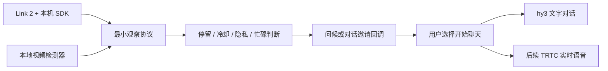

# Link 2 摄像头接入调查

核查日期：2026-09-23。目标：相框发现有人停留后，可以发出一次轻量问候；未来可升级为确认对方正在看相框再问候。当前交付为接口与触发策略，未连接实际摄像头。

## 官方资料与可用能力

影石已有公开的 [Link SDK 仓库](https://github.com/Insta360Develop/Link-SDK)，不能沿用“影石 SDK 只支持全景相机”的旧结论。[Link UVC 开发指南](https://github.com/Insta360Develop/Insta360-Developer_Docs/blob/caa3700d0bf2a1b96317211f64431bcd0dfe11c0/docs/en/sdk/link/uvc/guide.md) 列出 Link 2，支持 Windows、macOS、Ubuntu 22.04。核查的 SDK 提交为 `2dd2c78186b0335a530042ae49accbef249d6a95`，文档提交为 `caa3700d0bf2a1b96317211f64431bcd0dfe11c0`，均为 2026-09-08 更新。

本次同时核对了固定版本的 [Windows x64 接口头文件](https://github.com/Insta360Develop/Link-SDK/blob/2dd2c78186b0335a530042ae49accbef249d6a95/UVCCamera_win/x64/include/uvc_camera.h) 和 [结构定义](https://github.com/Insta360Develop/Link-SDK/blob/2dd2c78186b0335a530042ae49accbef249d6a95/UVCCamera_win/x64/include/uvc_common.h)：

| 需求 | 官方接口或依据 | 接入含义 |
| --- | --- | --- |
| 枚举设备 | `uvc::GetUVCCameraList` | 由相框所在主机选择实际设备，不能在腾讯云函数上读取 USB 摄像头 |
| 人脸目标 | `UVCCameraExtendController::GetTrackObjLists` / `GetNewTrackObjLists` | 成功返回当前人头位置列表，最多 10 个；可作为“画面内有人”的候选证据 |
| 隐私状态 | `GetPrivacyMode(int&, bool&)` | 隐私中、读取失败或设备拔出均应停止触发；不自动调用退出隐私模式 |
| 检测数据 | `UVCRect` 的位置与宽高 | 不是人物身份、视线、眼球坐标或算法置信度 |
| 注视相框 | 本次查阅的接口未发现对应能力 | 需要独立的本地注视估计器或专用设备；预留能力标记，缺失时保持未知 |

以上是接口存在的证据，不代表某个固件、平台、拍摄距离下实际读取成功。必须检查每次调用的返回值，不能把失败当作“没人”，也不能把人脸框当成“正在看相框”。

[官方兼容说明](https://onlinemanual.insta360.com/link2/en-us/faq/compatibility/camera) 确认 UVC/UAC 视频和音频兼容；[外接设备说明](https://onlinemanual.insta360.com/link2c/en-us/operating-tutorials/camera-connect/connect) 说明设备连接依赖主机支持，Link 系列目前不支持直接有线连接手机。因此优先按“Link 2 USB 接相框主机”设计，网页取流与本机原生 SDK 作为两条可替换适配路径。

[官方隐私说明](https://onlinemanual.insta360.com/link2/en-us/faq/operationtutorials/privacyprotection) 提到重新开启视频流会唤醒相机。因此未来启用按钮必须是明确操作，后台恢复、异常重试和普通页面加载不应擅自重启视频流。

## 项目接入方案

1. 本机适配器输出最小观察值：时间、有人/无人/未知、可选注视状态、隐私与设备状态；原始图像留在主机。
2. 独立触发控制器负责连续停留、观察过期、离开后重置、问候冷却、页面可见性与对话忙碌状态。
3. 通过问候回调接入现有 AI 或实时语音会话。摄像头只提供触发信号，不承担大模型对话，也不自动发送家庭留言。
4. 人脸目标先用于在场模式；只有适配器明确支持且输出有效注视证据时，才允许注视模式触发。
5. 未来本机 SDK 桥接需绑定本地应用权限。当前不新增未认证 localhost 服务或公网摄像头上传入口。

注视检测的候选基础是本地 [MediaPipe Face Landmarker](https://ai.google.dev/edge/api/mediapipe/python/mp/tasks/vision/FaceLandmarkerResult) 的人脸关键点和变换矩阵，再另加视线估计与相框位置校准。它不能直接被宣称为已完成的注视检测器；Google 的 [Iris 官方说明](https://github.com/google-ai-edge/mediapipe/blob/master/docs/solutions/iris.md) 也明确区分了虹膜跟踪和判断视线落点。本轮不下载模型或引入视觉依赖，先把两种信号的接口分开，避免后来换算法时重写对话策略。

接口、示例和测试见 [CAMERA-INTERFACE.md](CAMERA-INTERFACE.md)。SDK 二进制按上述官方仓库及其适用条款单独获取，本项目包保留接入代码和资料入口。

## 后续实机验收

- 核实实物确为 Link 2，并记录主机系统、USB 设备与固件版本。
- 验证目标列表在没人、单人、多人、背对、弱光、侧脸时的含义，确认是否要求开启视频流或特定追踪模式。
- 验证手动隐私、拔线、切后台、退出会话不会被自动重试唤醒。
- 验证停留与冷却是否自然，避免路过、照片中的人脸和连续停留反复问候。
- 如增加注视估计，单独验收看屏幕与看旁边、眼镜、距离和校准；不能用“检测到人脸”替代。
- 真实麦克风、扬声器回声与打断延迟由实时语音验收独立记录。

本次没有摄像头连接、真实人脸/注视检测、真人麦克风或扬声器的验收证据。
